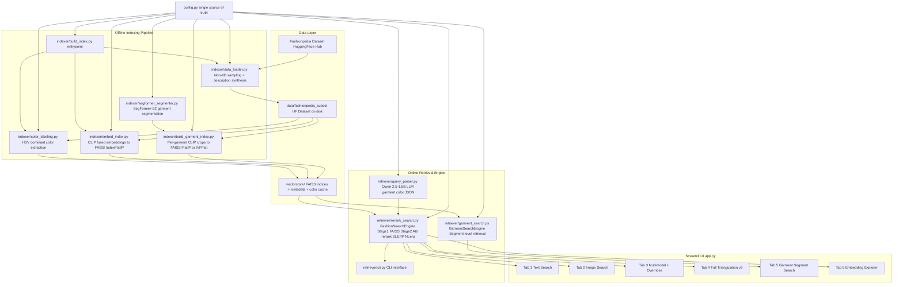

# 🏗️ Architecture — Fashion Search Studio

> **Version:** v3 | **Last Updated:** 2026-09-25

This document describes the complete system architecture of the Fashion Search Studio, an end-to-end multimodal fashion image retrieval engine built on CLIP, SegFormer, FAISS, and a lightweight LLM query parser.

---

## 1. High-Level System Overview



---

## 2. Indexing Pipelines (Offline, Run Once)

### 2A. Full-Image FAISS Index

```
Fashionpedia dataset
        |
        v  load_dataset() + non-IID Dirichlet sampling (alpha=0.3)
  30,000-image subset  ──> saved to data/fashionpedia_subset
        |
  ┌─────┴──────────┐
  |                |
  v                v
Synthesize       Image pixels (RGB)
text captions         |
  |              CLIP ViT-B/32 encode_image()
  |                   |
CLIP tokenize     image_embed (512-dim, normalized)
  |
text_embed (512-dim, normalized)
  |
  └─── fused = alpha*img + (1-alpha)*text  ──> normalize ──> FAISS IndexFlatIP
  
Per-image garment bbox annotations ──> HSV color extraction ──> garment_colors dict

Output:
  vectorstore/fashionpedia_fused_index.faiss   (30k x 512)
  vectorstore/fashionpedia_metadata.pkl        (image_ids, descriptions, garment_colors)
  vectorstore/garment_colors_per_image.pkl     (cache)
```

### 2B. Per-Garment FAISS Index

```
Each image in subset
        |
        v  SegFormer-B2 (mattmdjaga/segformer_b2_clothes)
  Logits (1, 18_labels, H/4, W/4)
        |
        v  bilinear upsample + argmax
  Pixel seg map (H, W) with 18 raw class IDs
        |
        v  SEGFORMER_LABEL_TO_GARMENT mapping + area >= 1% filter
  Garment crops (top, pants, dress, shoe, belt, bag, scarf, hat, skirt)
        |
        v  CLIP encode_image() per crop, batched
  Crop embeddings (N_crops x 512)
        |
        v  IndexFlatIP (default) or IndexIVFFlat (--use-ivf)
  Per-garment FAISS index

Output:
  vectorstore/fashionpedia_garment_index.faiss
  vectorstore/fashionpedia_garment_meta.pkl    (image_index, image_id, garment_label per entry)
```

---

## 3. Two-Stage Retrieval

```
                      ┌──────────────────────────────────────┐
                      │         QUERY ENCODING               │
                      │                                      │
  Text query ─────────┤──> CLIP encode_text() ─────────────┐│
  Reference image ────┤──> CLIP encode_image() ────────────┤│
  Attribute overrides ┤──> CLIP("a {color} {garment}") x N ┤│
                      │    blend via SLERP or NLerp         ┤│
                      │                                     ││
                      │    Fused query vector (1 x 512)     ◄┘│
                      └─────────────────┬────────────────────┘
                                        │
                              ┌─────────▼──────────┐
                              │   STAGE 1: RECALL  │
                              │  FAISS IndexFlatIP │
                              │  .search(embed, k) │
                              │  k = candidate_pool│
                              │  (default: 100)    │
                              └─────────┬──────────┘
                                        │  candidate list
                      Text query ──> Qwen 2.5-1.5B ──> {garment: color} attrs
                                        │
                              ┌─────────▼───────────────────────┐
                              │   STAGE 2: ATTRIBUTE RE-RANK    │
                              │                                 │
                              │  clip_score = FAISS IP score    │
                              │  attr_score = garment color     │
                              │              match fraction     │
                              │  final = (1-w)*clip + w*attr    │
                              │  sort by final_score descending │
                              └─────────┬───────────────────────┘
                                        │
                                    Top-K Results
```

---

## 4. Garment Segment Search Pipeline

```
Reference image (PIL)
        |
        v  GarmentSegmenter.segment_garments_with_masks()
  SegFormer seg map -> garment crops with masks
        |
        v  find segment where garment == target_garment
  ┌─────┴──────────────────────────────┐
  |  Found?                            |
  | Yes: encode_crop(target_seg.crop)  | No (fallback): encode_full_image()
  └─────┬──────────────────────────────┘
        |
  (optional) color override: blend(crop_embed, CLIP("a {color} {garment}"), alpha)
        |
        v  garment FAISS index .search(embed, candidate_pool)
  Garment-level hits (image_index, garment_label, score)
        |
        v  de-duplicate by image_id, keep best score
  Top-K unique images

Returns: {results, query_crop, fallback, found_garment, segment_info}
```

---

## 5. Embedding Fusion Modes

### 5A. Standard Fusion (Image + Text)

`
fused = normalize( alpha * E_image + (1-alpha) * E_text )
`
Default: FUSE_ALPHA = 0.7 (image-dominant)

### 5B. Attribute Override Fusion — v2

`python
accumulated = encode_image(reference_image)
for garment, color in override_attrs.items():
    override_embed = encode_text(f"a {color} {garment}")
    accumulated = Blend(accumulated, override_embed, alpha_override)
    # Blend = SLERP or NLerp, then renormalize
`

### 5C. Full Triangulation — v3

`python
# Step 1: fuse text + image
fused = normalize( image_alpha * E_image + text_alpha * E_text )
# Step 2: apply each override (same as 5B)
for garment, color in override_attrs.items():
    fused = Blend(fused, encode_text(f"a {color} {garment}"), alpha_override)
`

---

## 6. Color Labeling (Indexing Time)

Each garment bounding box in Fashionpedia is color-labeled at indexing time (never recomputed at query time):

`
bbox pixels
    |
    v  median RGB (robust to edge noise and shadows)
  (r, g, b) in [0, 255]
    |
    v  colorsys.rgb_to_hsv()
  (h, s, v) in [0-360, 0-100, 0-100]
    |
    v  coarse bucket rules (HSV thresholds)
  color_name: black | white | gray | red | orange | brown |
              yellow | green | blue | purple | pink
`

Bucket logic lives in color_labeling.py::hsv_to_color_name().

---

## 7. Query Parsing Sequence

`
User: "a red tie with a white shirt"
    |
    v  QueryParser.parse()
  Build few-shot prompt (4 static examples + user query)
    |
    v  Qwen2.5-1.5B-Instruct.generate(max_new_tokens=40)
  Model output: '{"tie": "red", "shirt": "white"}'
    |
    v  re.search(r"\{.*?\}", decoded)
  Extracted JSON
    |
    v  Validate against KNOWN_GARMENTS + KNOWN_COLORS
  {tie: red, shirt: white}  <-- hallucinated garments/colors dropped
    |
    v  Stage 2 attribute re-ranker uses this dict
`

---

## 8. FAISS Index Type Comparison

| Index | Use Case | Exact? | Build Flag | Query Cost |
|---|---|---|---|---|
| IndexFlatIP | Full-image (30k) | Yes | uild_index.py | O(N) |
| IndexFlatIP | Per-garment, small | Yes | uild_garment_index.py | O(N_crops) |
| IndexIVFFlat | Per-garment, large | Approx (~95%+ recall) | --use-ivf | O(nprobe * N/nlist) |

IVF parameters in config.py:
- GARMENT_FAISS_NLIST = 64 — Voronoi partitions (recommended: sqrt(N))
- GARMENT_FAISS_NPROBE = 8 — cells probed per query

---

## 9. Module Dependency Graph

`
config.py
  |
  +-- indexer/data_loader.py     <-- indexer/build_index.py
  |                              <-- indexer/build_garment_index.py
  |                              <-- retriever/cli.py
  |                              <-- app.py
  |
  +-- indexer/color_labeling.py  <-- indexer/build_index.py
  |
  +-- indexer/embed_index.py     <-- indexer/build_index.py
  |                              <-- indexer/build_garment_index.py
  |                              <-- retriever/rerank_search.py
  |                              <-- retriever/garment_search.py
  |
  +-- indexer/segformer_segmenter.py  <-- indexer/build_garment_index.py
  |                                  <-- retriever/garment_search.py
  |                                  <-- app.py
  |
  +-- retriever/query_parser.py  <-- retriever/rerank_search.py (lazy)
  |
  +-- retriever/rerank_search.py <-- retriever/garment_search.py
  |                              <-- retriever/cli.py
  |                              <-- app.py
  |
  +-- retriever/garment_search.py <-- app.py
`

---

## 10. Caching and Lazy Loading Strategy

| Resource | Strategy | Reason |
|---|---|---|
| HF Dataset subset | @st.cache_resource | Avoid re-loading 30k images each re-run |
| FashionSearchEngine (CLIP + FAISS) | @st.cache_resource | CLIP model is ~150MB; FAISS index is ~60MB |
| GarmentSearchEngine (+ SegFormer) | @st.cache_resource | SegFormer-B2 is ~100MB |
| QueryParser (Qwen 1.5B) | Lazy @property | Only needed for text queries; ~3GB on CPU |
| Garment color cache | Pickle cache on disk | Extraction takes ~hours on 30k images |

---

*See [API_REFERENCE.md](API_REFERENCE.md) for function signatures, [DEVELOPER_GUIDE.md](DEVELOPER_GUIDE.md) for setup, and [SEARCH_MODES.md](SEARCH_MODES.md) for end-user feature descriptions.*
